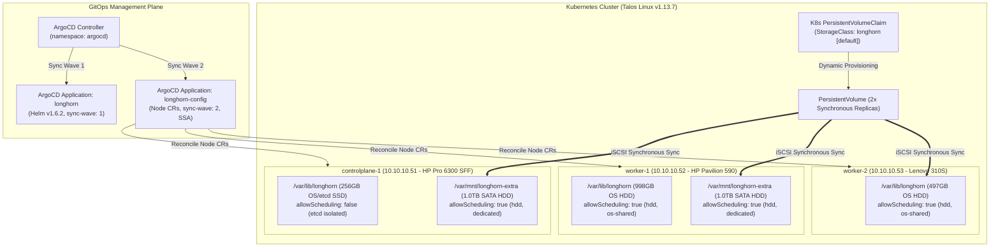

# Architecture Blueprint: Longhorn Distributed Storage (Feature 3.2 & Feature 4.1)

## 1. Abstract
* **Purpose:** Establishes resilient, distributed, persistent block storage with declarative multi-disk management and synchronous cross-node replication across bare-metal Talos Linux nodes.
* **Platform Tier:** Layer II (Storage & Physical Enclave Interface) & Layer III (Management Layer)
* **Owner:** Platform Engineering & ORSA Systems Architect

---

## 2. Logical Design



* **Service Type:** DaemonSet (`longhorn-manager`, `longhorn-csi-plugin`), Deployment (`longhorn-ui`, `csi-attacher`, `csi-provisioner`), Custom Resource Definitions (`nodes.longhorn.io/v1beta2`, `volumes.longhorn.io`, `replicas.longhorn.io`).
* **Namespace:** `longhorn-system` (Privileged PSA).
* **Communication Pattern:**
  * Host-Level: iSCSI target over TCP / local block device loop (`siderolabs/iscsi-tools`, `siderolabs/util-linux-tools`).
  * Node-to-Node: Synchronous volume replication over 1000BASE-T Gigabit Cilium CNI enclave network (`10.10.10.0/24`, TCP `9500-9501`).

---

## 3. Implementation Details

* **Repository Paths:**
  * `argocd/apps/longhorn.yaml` — Sync Wave `1` native Helm release (`longhorn` chart `v1.6.2`).
  * `argocd/apps/longhorn-config.yaml` — Sync Wave `2` Kustomize application (`ServerSideApply=true`, `ServerSideDiff=true`, `automated.prune: false`) reconciling `longhorn.io/v1beta2` `Node` CRs.
  * `infrastructure/storage/longhorn/kustomization.yaml` & `infrastructure/storage/longhorn/nodes/{controlplane-1,worker-1,worker-2}.yaml` — Declarative per-node disk topology.
  * `infrastructure/storage/README.md` — Subsystem documentation.
  * `docs/runbooks/cluster-access.md` — Longhorn UI port-forward access (`http://localhost:8081`).
* **Talos OS Extensions & Disk Provisioning (Plane 1):**
  * Extensions active across all 3 nodes (`10.10.10.51`, `10.10.10.52`, `10.10.10.53`): `siderolabs/iscsi-tools` and `siderolabs/util-linux-tools`.
  * Secondary SATA HDDs (`/dev/sdb1`, `1.0 TB` XFS) on `controlplane-1` and `worker-1` are provisioned via Talos `UserVolumeConfig` (`u-longhorn-extra`) and bind-mounted into kubelet at `/var/mnt/longhorn-extra` (`rshared`, `rw`).
* **Key Configuration Parameters (`argocd/apps/longhorn.yaml`):**
  * `persistence.defaultClass: true` (Sets `longhorn` as default K8s `StorageClass`)
  * `persistence.defaultClassReplicaCount: 2` (Enforces 2x synchronous replication across distinct nodes)
  * `defaultSettings.replicaSoftAntiAffinity: false` (Strict cross-node anti-affinity — two replicas of the same volume cannot co-locate on one physical node)
  * `defaultSettings.replicaAutoBalance: "least-effort"`
  * `csi.kubeletRootDir: "/var/lib/kubelet"`
  * `metrics.prometheus.enabled: true`

---

## 4. Resilience & Failure Domains

* **3-Node Fault Domain Pool:** `controlplane-1` (`1.0 TB` dedicated HDD), `worker-1` (`~1.8 TB` dual HDDs), and `worker-2` (`497 GB` HDD) form three independent physical fault domains backing `2`-replica volumes.
* **`etcd` I/O Isolation (`controlplane-1`):** Scheduling is explicitly disabled (`allowScheduling: false`) on `controlplane-1`'s 256 GB OS/etcd SSD (`default-disk-080400000000`), ensuring Longhorn block I/O never competes with `etcd` WAL/fsync latency.
* **Node Loss & Auto-Rebuilding:** If any single node goes offline, active volumes continue serving I/O from the surviving replica and can rebuild onto the third surviving node automatically.
* **GitOps Prune Protection:** `argocd/apps/longhorn-config.yaml` enforces `automated.prune: false` so Longhorn `Node` CRs are never accidentally deleted during sync operations.

---

## 5. Security Posture

* **Namespace Privileged Scoping:** Namespace `longhorn-system` is explicitly labeled `pod-security.kubernetes.io/enforce: privileged` to permit required iSCSI host path mounts and block device bindings.
* **Workload Isolation:** Non-privileged workload pods consume storage via standard Kubernetes `PersistentVolumeClaim` objects without requiring host privileges.

---

## 6. Verification & Validation (Definition of Done)

```bash
# 1. Verify ArgoCD applications are Synced and Healthy
kubectl get applications -n argocd longhorn longhorn-config
```

```bash
# 2. Verify Longhorn nodes report Ready and Schedulable
kubectl get nodes.longhorn.io -n longhorn-system
```

```bash
# 3. Verify all physical disks report Ready=True and expected capacities
kubectl get nodes.longhorn.io -n longhorn-system -o go-template='{{range .items}}{{.metadata.name}}{{"\n"}}{{range $k, $v := .status.diskStatus}}  {{$k}} -> max={{$v.storageMaximum}} avail={{$v.storageAvailable}} {{range $v.conditions}}{{.type}}={{.status}} {{end}}{{"\n"}}{{end}}{{end}}'
```

```bash
# 4. Verify etcd SSD isolation on controlplane-1 (must return: false)
kubectl get nodes.longhorn.io -n longhorn-system controlplane-1 -o jsonpath='{.spec.disks.default-disk-080400000000.allowScheduling}' && echo
```

```bash
# 5. Verify StorageClass 'longhorn' is set as default
kubectl get storageclass
```

```bash
# 6. Verify volume health and cross-node replica distribution
kubectl get volumes.longhorn.io -n longhorn-system -o custom-columns='NAME:.metadata.name,STATE:.status.state,ROBUSTNESS:.status.robustness,REPLICAS:.spec.numberOfReplicas,NODE:.status.currentNodeID'
```

```bash
# 7. Verify per-replica node placement, running state, and target disk path
kubectl get replicas.longhorn.io -n longhorn-system -o custom-columns='NAME:.metadata.name,VOLUME:.spec.volumeName,NODE:.spec.nodeID,STATE:.status.currentState,DISK:.spec.diskPath'
```
