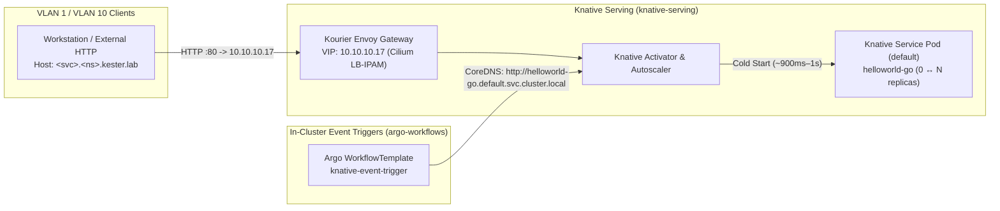

# 08 - Serverless Execution (Knative)

## 1. Abstract
* **Purpose:** Provides an enterprise-grade, scale-to-zero Function-as-a-Service (FaaS) compute layer powered by **Knative Serving**, mirroring AWS Lambda for event-driven analytic workloads and microservices.
* **Platform Tier:** Layer III (Management & Serverless Control Plane) & Layer IV (Event-Driven Analytic Compute)
* **Owner:** Platform Engineering & ORSA Systems Architect

---

## 2. Component Architecture

The serverless execution plane consists of four coordinated components reconciled declaratively via ArgoCD (`argocd/root-app.yaml` tracking `argocd-deploy`):

1. **Knative Operator (Wave 1 — `knative-operator`):**
   Deployed via Kustomize (`infrastructure/serverless/knative/operator`, pinned to `knative-v1.14.0/operator.yaml`), managing CRDs and lifecycle reconciliation for `KnativeServing`.
2. **Knative Serving Control Plane (Wave 2 — `knative-serving`):**
   Reconciled via `KnativeServing` CR (`infrastructure/serverless/knative/serving/knative-serving-cr.yaml`):
   * **Autoscaler (KPA):** Monitors request concurrency and scales revisions dynamically, including down to `0` replicas after idle retention windows.
   * **Activator:** Intercepts traffic destined for scaled-to-zero revisions, buffers the HTTP request, signals the Autoscaler to instantiate a pod (cold start), and proxies the request once `2/2 Running`.
   * **Controller & Webhooks:** Reconcile `Service`, `Configuration`, `Revision`, `Route`, `PodAutoscaler`, and `ServerlessService` CRDs.
3. **Kourier Ingress Gateway (Layer II/III — `knative-serving`):**
   Lightweight Envoy-based gateway dedicated exclusively to Knative traffic (per [ADR-0009](../adr/0009-serverless-knative-ingress.md)). Assigned VIP **`10.10.10.17`** from `CiliumLoadBalancerIPPool/homelab-lb-pool` (`10.10.10.17–10.10.10.25`) and ARP-announced via `CiliumL2AnnouncementPolicy` (separate from NGINX Ingress on `10.10.10.18`).
4. **Event-Driven Workflow Trigger Bridge (`argo-workflows`):**
   `WorkflowTemplate/knative-event-trigger` (`infrastructure/bootstrap/argo-workflows/knative-trigger-workflow-template.yaml`) bridges **Argo Workflows** (AWS Step Functions equivalent) to **Knative Serving** (AWS Lambda equivalent) over cluster-internal DNS.

---

## 3. Routing & Trigger Architecture

* **External Enclave Routing (`kester.lab`):** Configured via `spec.config.domain` (`kester.lab: ""`). Clients address Kourier VIP `10.10.10.17` with `Host: <service>.<namespace>.kester.lab`. Wildcard DNS and automated TLS (`cert-manager`) are deferred to Epic 4 (Feature 4.2).
* **In-Cluster Event-Driven Routing (`svc.cluster.local`):** Internal orchestrators (Argo Workflows DAGs, GitLab Runner jobs) invoke `http://<service>.<namespace>.svc.cluster.local` directly over CoreDNS without external DNS or gateway hops.

---

## 4. Operational Guardrails & Resource Posture

* **Cluster Capacity (Post-Feature 3.4-R):** Following the all-desktop hardware consolidation ([ADR-0010](../adr/0010-plane-1-remote-state-and-hardware-consolidation.md)), the cluster operates with **40 GB total RAM** (`controlplane-1`: 20 GB, `worker-1`: 12 GB, `worker-2`: 8 GB) on **1000BASE-T Gigabit Ethernet**. Knative Serving control plane pods distribute cleanly across all three nodes without memory starvation.
* **Deterministic KPA Binding & Container Hardening:** All Knative `Service` manifests explicitly declare `autoscaling.knative.dev/class: "kpa.autoscaling.knative.dev"` to prevent bootstrap webhook race conditions, alongside hardened `securityContext` defaults (`runAsNonRoot: true`, `allowPrivilegeEscalation: false`, `capabilities.drop: ["ALL"]`, `seccompProfile.type: RuntimeDefault`).
* **Non-Overlapping LB-IPAM:** `CiliumLoadBalancerIPPool/homelab-lb-pool` is bounded explicitly to `10.10.10.17–10.10.10.25`, preventing ARP/IP collisions with the ER605 VLAN 10 DHCP pool (`10.10.10.30–10.10.10.99`).
